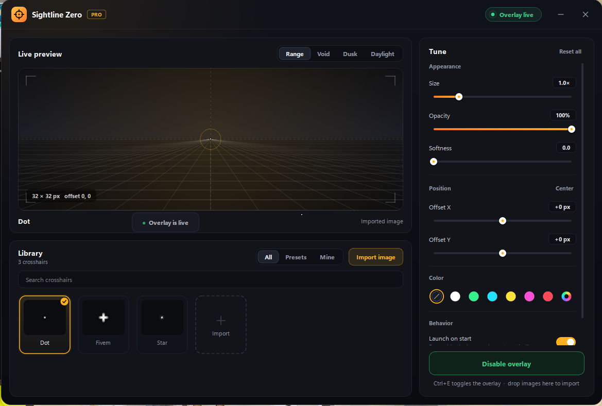

# Sightline Zero

A small desktop app that puts a crosshair on your screen. Pick one from the library, tweak it until it looks right, hit enable, and it sits on top of your game or whatever else you're running. Clicks go straight through it, so it never gets in the way.



I wanted something that looks and feels like the polished crosshair tools out there, but runs from a single Python file you can read and change yourself.

## Getting it running

You need Python 3.9 or newer.

```
pip install -r requirements.txt
python crosshair.py
```

On first launch it creates a `crosshairs` folder next to the script and fills it with a dozen built-in presets, so there's something to play with right away.

## How to use it

1. Click a crosshair in the library. The preview updates straight away.
2. Adjust it on the right: size, opacity, softness, color and position.
3. Press **Enable overlay** (or `Ctrl+E`). Press it again to turn it off.

Your settings are saved automatically in `config.json`, and if "Launch on start" is on, the overlay comes back the next time you open the app.

## What's in it

- **Live preview** with four backdrops (Range, Void, Dusk, Daylight). Daylight is handy for checking that your crosshair is still visible on bright scenes.
- **Size, opacity and softness** sliders. Double-click any slider to reset it.
- **Offset X / Y** if your crosshair needs to sit slightly off center. There's a Center button to snap it back.
- **Color**: seven quick swatches plus a custom picker. Recoloring keeps dark outlines intact, so the crosshair stays readable.
- **Library** with search and All / Presets / Mine filters.
- **Your own crosshairs**: use the Import button, or just drag PNG, JPG or WebP files onto the window. Right-click a card to delete it or open the folder.
- **Click-through overlay** that never steals focus from your game.

## Using your own images

Any image with a transparent background works. Something between 32 and 256 pixels square is a good size to start with, since you can scale it from the app anyway. Imported files are copied into the `crosshairs` folder, so your originals aren't touched.

If you delete a built-in preset by accident, right-click an empty spot in the library and choose "Restore built-in presets".

## Things worth knowing

- The overlay is drawn on your primary monitor.
- Games running in exclusive fullscreen can hide overlays. Borderless windowed mode is the reliable fix.
- The click-through behavior is set up for Windows. On other systems the overlay still shows, but click-through may not work.
- Some online games treat screen overlays as suspicious. Check the rules of whatever you're playing before you rely on this.

## Files

| File | What it is |
| --- | --- |
| `crosshair.py` | The whole app |
| `requirements.txt` | Python dependencies |
| `config.json` | Your saved settings (created automatically) |
| `crosshairs/` | The crosshair images (created automatically) |
